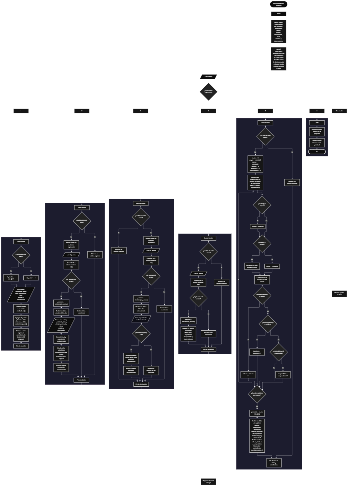

 

Este proyecto, llamado <b>administrador de avatares</b>, fue desarrollado en <b>python</b> como un ejercicio práctico para fortalecer la lógica de programación mediante la creación de un sistema de gestión de avatares desde la consola. El programa cuenta con un menú principal de seis opciones que permite <b>crear, editar, eliminar, buscar y listar</b> los avatares registrados, además de consultar estadísticas generales sobre sus niveles, experiencias y estados. Cada avatar almacena información como el nombre, el propietario, la clase, el nivel, la experiencia, la raza, el estado y las observaciones, utilizando nueve listas relacionadas para organizar los registros durante la ejecución. Durante su desarrollo se aplicaron conceptos fundamentales de programación, como variables, listas, estructuras condicionales, ciclos repetitivos, búsqueda de registros, modificación de datos, eliminación de elementos y operaciones estadísticas. Este proyecto permite poner en práctica los conocimientos adquiridos en python y sirve como base para desarrollar sistemas de administración más avanzados utilizando otros lenguajes y tecnologías.

<h2 align="center">⚙️ Funcionamiento del menú principal</h2>

### ➕ Crear avatar

La opción <b>1) crear avatar</b> permite registrar un nuevo avatar en el sistema. Antes de almacenar los datos, el programa determina el identificador que se asignará al registro mediante la condición <b>len(ids) == 0</b>. Si la lista está vacía, el primer identificador será <b>1</b>; de lo contrario, utiliza <b>ids[-1] + 1</b> para calcular el siguiente identificador a partir del último elemento de la lista. Después, solicita el <b>nombre del avatar, nombre del propietario, clase, nivel, experiencia, raza, estado y observación</b>. Los valores de nivel y experiencia se convierten a números enteros mediante la función <b>int()</b>. Finalmente, los datos se agregan a sus respectivas listas utilizando <b>append()</b> y se muestran los mensajes <b>"avatar registrado correctamente."</b> y el identificador asignado. El registro se almacena temporalmente durante la ejecución del programa.

### ✏️ Editar avatar

La opción <b>2) editar avatar</b> permite modificar la información de un avatar registrado. Primero, el programa comprueba si existen registros mediante la condición <b>len(ids) == 0</b>. Si no hay avatares almacenados, muestra el mensaje <b>"no existen registros."</b>. En caso contrario, utiliza un ciclo <b>for</b> para mostrar todos los avatares con sus respectivos datos e identificadores. Después, solicita el identificador del registro que se desea editar y lo convierte a entero mediante <b>int()</b>. Si el identificador se encuentra en la lista <b>ids</b>, utiliza <b>ids.index(id_buscar)</b> para obtener la posición del registro, muestra sus datos actuales y solicita la nueva información del avatar. Los ocho campos se actualizan directamente en las listas correspondientes, mientras que el identificador original se conserva. Finalmente, presenta el mensaje <b>"registro actualizado correctamente."</b>. Si el identificador no existe, muestra el mensaje <b>"id no encontrada."</b>.

### 🗑️ Eliminar avatar

La opción <b>3) eliminar avatar</b> permite eliminar un registro mediante su identificador. Primero, el programa comprueba si existen avatares almacenados. Si no hay registros, muestra el mensaje <b>"no existen registros."</b>. Si existen, presenta la lista de avatares con todos sus datos y solicita el identificador del registro que se desea eliminar. Después de convertirlo a entero, comprueba si se encuentra en <b>ids</b> y utiliza <b>ids.index(id_buscar)</b> para localizar su posición. A continuación, muestra la información del avatar seleccionado y solicita confirmación mediante la pregunta <b>"¿desea eliminar este registro? (s/n):"</b>. Si la respuesta, convertida a mayúsculas mediante <b>upper()</b>, es igual a <b>"S"</b>, elimina el elemento de las nueve listas utilizando <b>pop(posicion)</b>. De esta manera, los datos relacionados se eliminan de la misma posición y se mantiene la correspondencia entre las listas. Finalmente, muestra el mensaje <b>"registro eliminado correctamente."</b>. Si no se confirma la operación, presenta el mensaje <b>"el registro no fue eliminado."</b>. Si el identificador no existe, muestra <b>"id no encontrada."</b>.

### 🔎 Buscar avatar

La opción <b>4) buscar avatar</b> permite localizar un avatar mediante su identificador. Primero, el programa comprueba si existen registros. Si la lista está vacía, muestra el mensaje <b>"no existen registros."</b>. En caso contrario, solicita el identificador que se desea buscar y lo convierte a entero mediante <b>int()</b>. Después, utiliza la condición <b>id_buscar in ids</b> para comprobar si el registro existe. Si encuentra el identificador, obtiene su posición mediante <b>ids.index(id_buscar)</b> y muestra todos los datos del avatar: identificador, nombre, propietario, clase, nivel, experiencia, raza, estado y observaciones. Si el identificador no está registrado, presenta el mensaje <b>"id no encontrada."</b>. Esta operación permite consultar un registro específico sin recorrer manualmente todos los datos.

### 📋 Lista de datos

La opción <b>5) lista de datos</b> permite visualizar todos los avatares registrados y obtener estadísticas generales del sistema. Primero, comprueba si existen registros mediante la condición <b>len(ids) == 0</b>. Si no hay datos almacenados, muestra el mensaje <b>"no existen registros."</b>. Si existen avatares, inicializa las variables <b>suma, mayor, menor, activos, inactivos y suspendidos</b>. La variable <b>suma</b> comienza en cero y acumula los valores de la lista <b>experiencias</b>; las variables <b>mayor</b> y <b>menor</b> se inicializan con el primer nivel registrado para identificar el nivel más alto y el más bajo. A continuación, un ciclo <b>for</b> recorre las listas y muestra la información de cada avatar, suma su experiencia y compara sus niveles para actualizar los valores máximo y mínimo. También cuenta los avatares cuyos estados coinciden con <b>"activo"</b>, <b>"inactivo"</b> y <b>"suspendido"</b>, utilizando <b>lower()</b> para ignorar las diferencias entre mayúsculas y minúsculas. Al terminar el recorrido, calcula el promedio de experiencia mediante <b>suma / len(ids)</b> y lo redondea a dos decimales con <b>round(promedio, 2)</b>. Finalmente, presenta la cantidad de registros, la experiencia acumulada, el promedio de experiencia, el mayor y el menor nivel, y la cantidad de avatares activos, inactivos y suspendidos.

### 🚪 Salir del menú principal

La opción <b>6) salir</b> permite finalizar la ejecución del programa. Cuando el usuario selecciona esta opción, el sistema muestra el mensaje <b>"gracias por utilizar el programa."</b> y ejecuta la instrucción <b>break</b>, que termina el ciclo repetitivo <b>while True</b>. De esta manera, el menú principal deja de mostrarse y el programa finaliza su ejecución. Si el usuario introduce un valor que no corresponde a ninguna de las seis opciones disponibles, el sistema presenta el mensaje <b>"opción inválida."</b> y vuelve a mostrar el menú principal.

<h2 align="center">🧠 Temas aplicados en el proyecto</h2>

### 📦 Variables

En este proyecto se utilizan variables para almacenar temporalmente la información de los avatares, controlar los identificadores, seleccionar registros, recorrer las listas y calcular estadísticas. Cada variable cumple una función específica dentro de las operaciones de creación, edición, eliminación, búsqueda y listado de datos.

🔢 <b>opcion:</b> Almacena la opción seleccionada por el usuario en el menú principal.

🆔 <b>id_avatar:</b> Almacena el identificador que se asigna al nuevo avatar.

🔎 <b>id_buscar:</b> Guarda el identificador introducido por el usuario para localizar un registro.

📍 <b>posicion:</b> Almacena la posición del avatar dentro de las listas relacionadas.

🔄 <b>i:</b> Funciona como contador en los ciclos <b>for</b> utilizados para recorrer y mostrar los registros.

📊 <b>suma:</b> Acumula los valores de experiencia de todos los avatares registrados.

⬆️ <b>mayor:</b> Guarda el nivel más alto encontrado durante el recorrido de los registros.

⬇️ <b>menor:</b> Guarda el nivel más bajo encontrado durante el recorrido de los registros.

📈 <b>promedio:</b> Almacena el promedio de experiencia calculado a partir de la suma y la cantidad de registros.

🔢 <b>activos, inactivos y suspendidos:</b> Son contadores que registran la cantidad de avatares que coinciden con cada uno de los tres estados reconocidos por las estadísticas.

### 🗃️ Listas

En este proyecto se utilizan nueve listas relacionadas para almacenar los datos de los avatares. Cada lista contiene un tipo específico de información y todas mantienen la correspondencia entre registros mediante sus posiciones. Por ejemplo, el avatar ubicado en la posición <b>0</b> de la lista <b>avatares</b> está relacionado con el propietario de la posición <b>0</b> de <b>propietarios</b>, la clase de la posición <b>0</b> de <b>clases</b> y los demás datos almacenados en esa misma posición. Esta organización permite crear, consultar, modificar y eliminar registros manteniendo relacionados sus datos.

🆔 <b>ids:</b> Almacena los identificadores de los avatares registrados.

🎮 <b>avatares:</b> Almacena los nombres de los avatares.

👤 <b>propietarios:</b> Almacena los nombres de los propietarios.

⚔️ <b>clases:</b> Almacena las clases de los avatares.

⬆️ <b>niveles:</b> Almacena los niveles de los avatares como números enteros.

✨ <b>experiencias:</b> Almacena los valores de experiencia como números enteros.

🐉 <b>razas:</b> Almacena las razas de los avatares.

📌 <b>estados:</b> Almacena los estados indicados para cada avatar.

📝 <b>observaciones:</b> Almacena las observaciones adicionales de cada registro.

### 🔀 Estructuras condicionales

En este proyecto se utilizan las estructuras <b>if, elif y else</b> para controlar las operaciones del menú y determinar qué instrucciones deben ejecutarse según las condiciones del programa. Estas estructuras permiten comprobar si existen registros, determinar el identificador de un nuevo avatar, verificar si un identificador está almacenado, confirmar la eliminación de un registro, clasificar los estados de los avatares y mostrar un mensaje cuando se introduce una opción inválida. Las condiciones permiten que el programa responda de manera diferente según los datos almacenados y las decisiones del usuario.

### 🔄 Estructuras repetitivas

En este proyecto se utilizan los ciclos <b>while</b> y <b>for</b>. El ciclo <b>while True</b> mantiene activo el menú principal para que el usuario pueda realizar distintas operaciones hasta seleccionar la opción de salida. Por otro lado, los ciclos <b>for</b> permiten recorrer las listas utilizando el rango generado por <b>range(len(ids))</b>. Estos recorridos se emplean para mostrar los registros durante las operaciones de edición y eliminación, así como para presentar todos los avatares y calcular las estadísticas de la lista de datos.

### 🎯 Selección de opciones

El programa utiliza una estructura condicional formada por <b>if, elif y else</b> para evaluar el valor de la variable <b>opcion</b>. Cada condición representa una de las seis opciones del menú principal: crear, editar, eliminar, buscar, listar datos y salir. Cuando el valor introducido coincide con una opción, se ejecuta el bloque de instrucciones correspondiente. Si no coincide con ninguna de las opciones disponibles, se ejecuta el bloque <b>else</b>, que muestra el mensaje <b>"opción inválida."</b>.

### 🔎 Búsqueda de registros

La búsqueda de registros se realiza mediante las operaciones <b>in</b> e <b>index()</b>. Primero, el programa comprueba si el identificador introducido se encuentra en la lista <b>ids</b>. Si existe, utiliza <b>ids.index(id_buscar)</b> para obtener la posición correspondiente. Esa posición se utiliza posteriormente para consultar, modificar o eliminar los datos del avatar en las listas relacionadas. Este procedimiento permite identificar un registro por su ID y acceder a su información sin depender del nombre del avatar.

### 🔢 Conversión de tipos de datos

El programa utiliza la función <b>int()</b> para convertir las entradas del usuario en números enteros cuando se solicita un identificador, un nivel o una experiencia. Esta conversión permite comparar identificadores numéricos, almacenar niveles y experiencias como enteros y realizar operaciones aritméticas con los datos registrados. Las demás entradas, como el nombre del avatar, el propietario, la clase, la raza, el estado y las observaciones, se almacenan como texto.

### 📊 Cálculos estadísticos

La opción de lista de datos incorpora operaciones estadísticas que permiten conocer características generales de los avatares registrados. La variable <b>suma</b> acumula la experiencia de todos los registros, mientras que <b>promedio</b> calcula la experiencia media dividiendo esa suma entre la cantidad de avatares. Las variables <b>mayor</b> y <b>menor</b> permiten identificar los niveles máximo y mínimo mediante comparaciones sucesivas. Por último, los contadores <b>activos, inactivos y suspendidos</b> permiten conocer cuántos avatares tienen cada uno de esos estados. El promedio se presenta redondeado a dos decimales mediante <b>round()</b>.

<h2 align="center">¿Cómo se implementaron las operaciones crud en el proyecto?</h2>

Las operaciones <b>crud</b> se implementaron mediante las opciones del menú principal, permitiendo administrar los avatares registrados. La operación <b>crear</b> corresponde a <b>crear avatar</b>, donde se solicitan los datos y se incorporan a las nueve listas; <b>leer</b> se realiza mediante las opciones <b>buscar avatar y lista de datos</b>, que permiten consultar un registro específico o visualizar todos los avatares junto con sus estadísticas; <b>actualizar</b> corresponde a <b>editar avatar</b>, donde se modifican los ocho campos de información conservando el identificador; y <b>eliminar</b> se realiza mediante <b>eliminar avatar</b>, que solicita confirmación antes de retirar el registro de las nueve listas. Estas operaciones utilizan condicionales, ciclos, búsquedas por identificador y métodos de listas para gestionar los datos durante la ejecución del programa.

<h2 align="center">Diagrama de flujo del proyecto</h2>

<h2 align="center">🛡️ Validaciones del programa</h2>

### 📭 No existen registros

Esta comprobación se utiliza en las opciones de <b>editar, eliminar, buscar y lista de datos</b>. El programa evalúa la condición <b>len(ids) == 0</b> para determinar si hay avatares almacenados. Si la lista está vacía, muestra el mensaje <b>"no existen registros."</b> y no continúa con la operación que requiere datos. Esta comprobación evita intentar consultar o modificar un avatar cuando todavía no se ha registrado ninguno.

### 🔎 Identificador no encontrado

Esta comprobación se utiliza en las opciones de <b>editar, eliminar y buscar avatar</b>. Después de solicitar el identificador, el programa verifica si el valor introducido se encuentra en la lista <b>ids</b>. Si existe, obtiene su posición con <b>ids.index(id_buscar)</b> y continúa con la operación correspondiente. Si no existe, muestra el mensaje <b>"id no encontrada."</b>. De esta manera, el programa evita realizar esas operaciones sobre un identificador que no está almacenado.

### 🗑️ Confirmación de eliminación

Antes de eliminar un avatar, el programa solicita una respuesta mediante la pregunta <b>"¿desea eliminar este registro? (s/n):"</b>. La respuesta se convierte a mayúsculas utilizando <b>upper()</b> y se compara con el valor <b>"S"</b>. Si coincide, se eliminan los datos del registro mediante <b>pop(posicion)</b> en cada una de las nueve listas. Si la respuesta es diferente de <b>"S"</b>, el programa conserva el registro y muestra el mensaje <b>"el registro no fue eliminado."</b>.

### ⚠️ Opción inválida

El menú principal utiliza una condición <b>else</b> para detectar las entradas que no coinciden con las opciones disponibles. Si el usuario introduce un valor distinto de <b>1, 2, 3, 4, 5 o 6</b>, el programa muestra el mensaje <b>"opción inválida."</b> y continúa con el ciclo principal para volver a presentar el menú.

### 🔢 Conversión de valores numéricos

El programa utiliza <b>int()</b> para convertir los identificadores, niveles y experiencias a números enteros. Sin embargo, el código actual no incorpora un manejo de excepciones para las entradas no numéricas. Si el usuario introduce texto que no puede convertirse a entero en uno de esos campos, la ejecución puede generar un error. Tampoco se comprueba que los niveles y las experiencias sean valores positivos, por lo que el programa acepta cualquier entero que pueda convertirse correctamente.

### 📌 Clasificación de estados

Durante el cálculo de estadísticas, el programa utiliza <b>lower()</b> para comparar los estados sin distinguir entre mayúsculas y minúsculas. Los contadores reconocen únicamente los valores <b>"activo"</b>, <b>"inactivo"</b> y <b>"suspendido"</b>. Si un avatar tiene otro estado, su registro se muestra normalmente, pero ese estado no se suma a ninguno de los tres contadores. El programa tampoco restringe la entrada del estado durante la creación o edición del avatar.

<h2 align="center">🎯 Objetivo del proyecto</h2>

El objetivo principal de este proyecto es fortalecer la <b>lógica de programación</b> mediante el desarrollo de un sistema de administración de avatares en <b>python</b>. A través de su construcción se busca aplicar los conocimientos adquiridos sobre variables, listas, estructuras condicionales, ciclos repetitivos, búsqueda de registros, modificación y eliminación de datos, así como cálculos estadísticos. Además, el proyecto permite comprender cómo organizar información relacionada mediante listas paralelas, administrar registros identificados por un ID y obtener estadísticas a partir de los datos almacenados. De esta manera, se establece una base para desarrollar sistemas de gestión más completos utilizando otros lenguajes y tecnologías.

